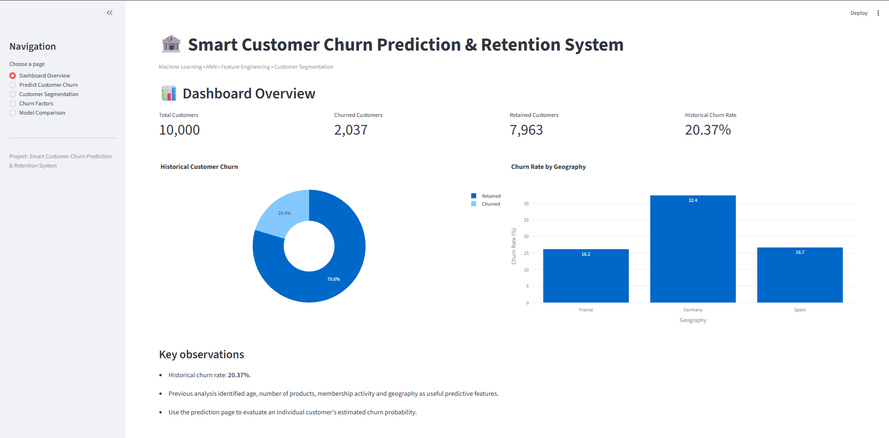
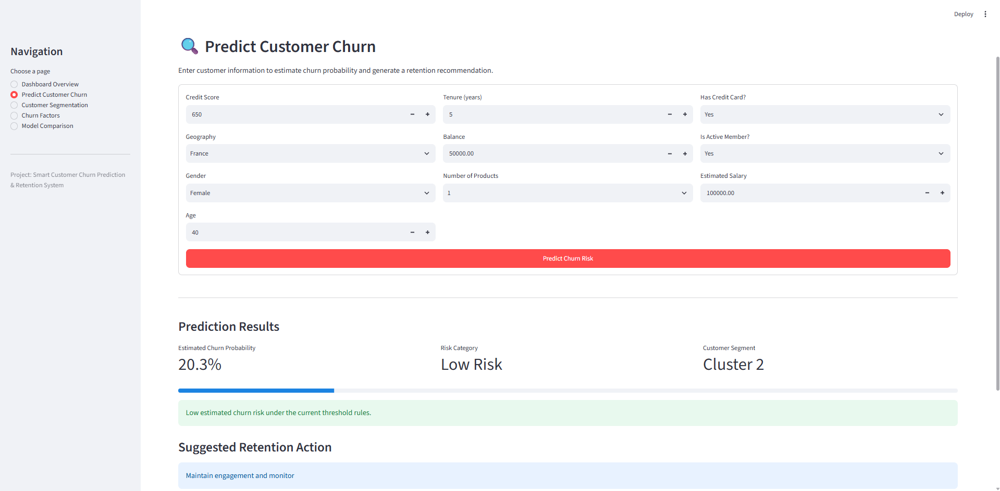
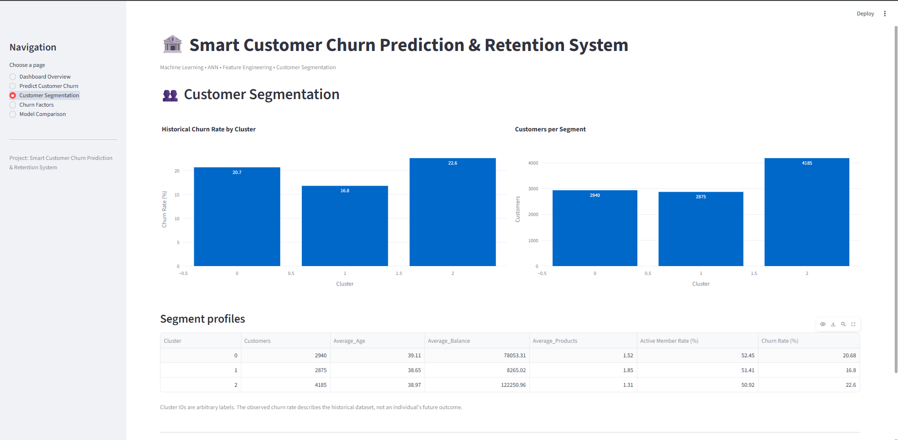
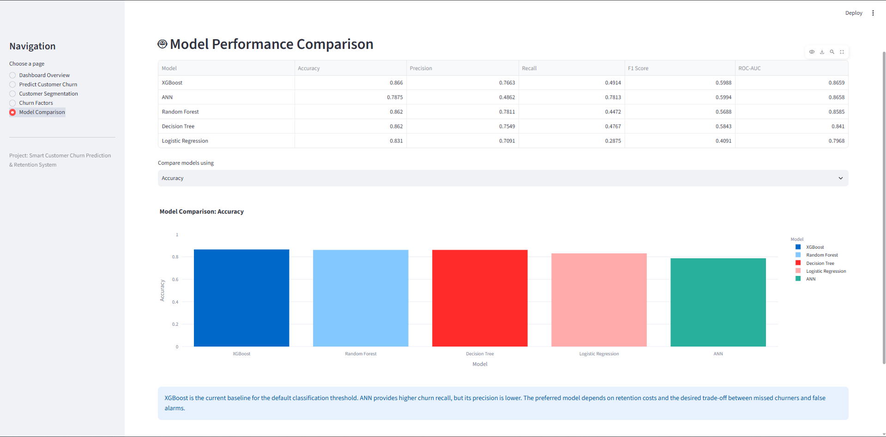

# Smart Customer Churn Prediction & Retention System

A machine-learning project that estimates the probability that a bank customer will leave, assigns a provisional churn-risk category, groups customers into segments, and suggests rule-based retention actions through a Streamlit dashboard.

## Features

- **Dashboard Overview:** Historical churn rate, retained/churned counts, and churn rate by geography.
- **Predict Customer Churn:** Enter customer details and receive an estimated churn probability, provisional risk category, customer cluster, and suggested retention action.
- **Customer Segmentation:** K-Means customer segments and their historical profiles.
- **Churn Factors:** XGBoost feature-importance visualization.
- **Model Comparison:** Comparison of Logistic Regression, Decision Tree, Random Forest, XGBoost, and ANN experiment metrics.

## Models and methods

- Classification: Logistic Regression, Decision Tree, Random Forest, XGBoost, and Artificial Neural Network (ANN).
- Feature engineering: `AgeGroup`, `BalanceCategory`, and `ProductsPerTenure`.
- Preprocessing: numerical imputation/scaling and categorical encoding.
- Segmentation: K-Means clustering.
- App: Streamlit, with Plotly visualizations.

The dashboard currently uses the XGBoost model for individual predictions. The model-comparison page displays saved experiment metrics; it does not retrain or reevaluate all models at app runtime.

## Dataset

The project was developed with the Bank Customer Churn Modelling dataset (`Churn_Modelling.csv`, 10,000 rows and 14 columns). Make sure you have permission to redistribute the dataset before committing it to a public repository. This repository setup ignores the local CSV by default; users should obtain it from the dataset's original source and place it beside `app.py` if they want historical analytics.

Expected local dataset filename for this app: `Churn_Modelling_dataset.csv`.

## Project structure

```text
Smart-Customer-Churn/
├── app.py
├── requirements.txt
├── README.md
├── .gitignore
├── Churn_Modelling_dataset.csv     # local dataset; ignored by Git
└── saved_models/
    ├── xgboost_churn_model.json
    ├── churn_preprocessor.pkl
    ├── cluster_preprocessor.pkl
    ├── kmeans_model.pkl
    └── churn_ann.keras             # optional for current dashboard
```

The current dashboard needs these four artifacts to run:
- `saved_models/xgboost_churn_model.json`
- `saved_models/churn_preprocessor.pkl`
- `saved_models/cluster_preprocessor.pkl`
- `saved_models/kmeans_model.pkl`

The ANN file is not loaded by the current `app.py`; it is optional unless you add ANN inference to the application.

## Setup

Use Python 3.12 and a virtual environment.

### Windows PowerShell

```powershell
py -3.12 -m venv .venv
.\.venv\Scripts\Activate.ps1
python -m pip install --upgrade pip
python -m pip install -r requirements.txt
python -m streamlit run app.py
```

The app will print a local URL, usually `http://localhost:8501`.

## Model evaluation

The current dashboard records the following experiment results:

| Model | Accuracy | Precision | Recall | F1 score | ROC-AUC |
|---|---:|---:|---:|---:|---:|
| XGBoost | 0.8660 | 0.7663 | 0.4914 | 0.5988 | 0.8659 |
| Random Forest | 0.8620 | 0.7811 | 0.4472 | 0.5688 | 0.8585 |
| Decision Tree | 0.8620 | 0.7549 | 0.4767 | 0.5843 | 0.8410 |
| Logistic Regression | 0.8310 | 0.7091 | 0.2875 | 0.4091 | 0.7968 |
| ANN | 0.7875 | 0.4862 | 0.7813 | 0.5994 | 0.8658 |

These are saved experiment results, not live evaluations performed when the dashboard starts. The classification threshold used for the XGBoost results was the default threshold unless otherwise documented in the training notebook.

## Important limitations

- Risk categories use provisional thresholds: below 0.30 = Low Risk, 0.30 to below 0.60 = Medium Risk, and 0.60 or above = High Risk. Validate these thresholds against business costs and validation data before real use.
- Retention suggestions are rule-based examples, not evidence that a particular action will prevent churn.
- Cluster IDs are arbitrary labels. The observed cluster churn rates describe the historical dataset and do not establish causation.
- Feature importance indicates how the fitted model uses features; it does not prove that a feature causes churn.
- This is an academic prototype, not a production banking decision system. Do not use it to make consequential customer decisions without validation, security, privacy, fairness, and compliance reviews.

## GitHub notes

- Do not commit `.venv/`, secrets, local logs, or private customer data.
- Review the dataset's license before redistributing it.
- The saved model artifacts are required to run inference. If any artifact is too large for GitHub's normal file limits, use Git LFS or a suitable model-artifact hosting solution.
- Only commit files you understand and are allowed to publish.

## 📸 Project Screenshots

### Dashboard Overview


### Customer Churn Prediction


### Customer Segmentation


### Model Comparison


## License

No license is specified yet. Add a license only after deciding how you want others to use, modify, and redistribute the project.
